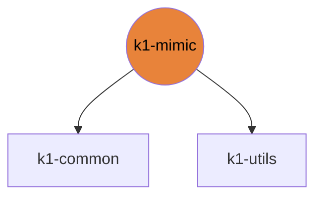

# k1-mimic

Video/text to K1 motion retargeting (GVHMR, GMR, SOMA, Kimodo) with a Gradio UI.

| | |
|---|---|
| Layer | **L2**: Domain (no cross-imports) |
| May import | [k1-common](https://github.com/thdhyan/k1-common), [k1-utils](https://github.com/thdhyan/k1-utils) |
| Files / LOC | 19 files · 3,722 lines (py, sh, cpp) |
| Part of | [k1-workspace](https://github.com/thdhyan/k1-workspace) (architecture and layering rules live there) |

## Where it sits



Used by: nothing (top layer).


## Install

```bash
uv add git+https://github.com/thdhyan/k1-mimic
# or, from a checkout
uv sync
```

## Layout

```
README.md
pyproject.toml
scripts/  (8 files)
  README.md
  gmr_bvh_to_k1_csv.py
  gmr_pkl_to_k1_csv.py
  mk_soma_k1_target.py
  motion_feasibility_gate.py
  record_k1_motion.py
  restart_k1m_app.sh
  soma_csv_to_k1_csv.py
service/  (1 files)
  k1m_service.py
src/  (12 files)
  k1m/  (12 files)
```

## Dependencies

- Declared sibling libraries: k1-common, k1-utils (see `pyproject.toml`, `[tool.uv.sources]`).
- PyPI: fastapi, gradio, imageio, mujoco, numpy, pillow, scipy, torch.
- Provided by the environment (ROS 2, Isaac, mjlab, robot SDK) or unresolved: `general_motion_retargeting`, `newton`, `rclpy`, `sensor_msgs`, `smplx`, `soma`, `soma_retargeter`, `std_msgs`, `warp`.

## Hard-coded paths into other repos

These files still name paths that now live in another repo (hard-coded path strings, not imports). Pass them as arguments / config when you touch the file:

| File | Refers to | Owner |
|---|---|---|
| `src/k1m/remote_stages.py` | `tools/` | k1-web-console |

## Origin

Extracted from `booster_ws` (branch `dev/push-training-wip`, working tree of 2026-11-03) by
`tools/build_workspace.py` in k1-workspace. Old path to new path for every file: [`docs/migration_map.tsv`](https://github.com/thdhyan/k1-workspace/blob/main/docs/migration_map.tsv) (filter on `k1-mimic`).
History was not carried over: the working tree was copied as is, including previously untracked files.
