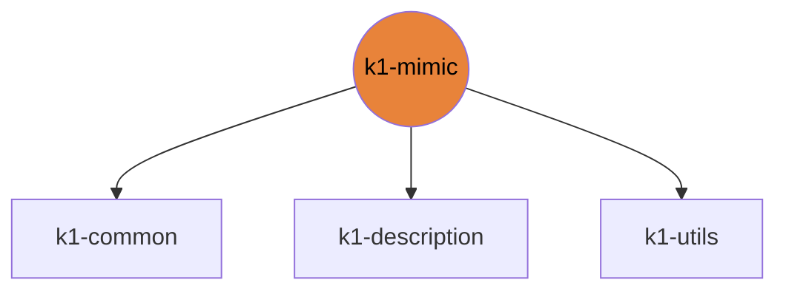

# k1-mimic

Video/text to K1 motion retargeting (GVHMR, GMR, SOMA, Kimodo) with a Gradio UI.

| | |
|---|---|
| Layer | **L2**: Domain (no cross-imports) |
| May import | [k1-common](https://github.com/thdhyan/k1-common), [k1-description](https://github.com/thdhyan/k1-description), [k1-utils](https://github.com/thdhyan/k1-utils) |
| Files / LOC | 20 files · 3,785 lines (py, sh, cpp) |
| Part of | [k1-workspace](https://github.com/thdhyan/k1-workspace) (architecture and layering rules live there) |

## Where it sits



Used by: nothing (top layer).


## Install

```bash
uv add git+https://github.com/thdhyan/k1-mimic
# or, from a checkout
uv sync
```

## Usage

Video or text to K1 joint angles. The heavy stages (GVHMR, Kimodo, GMR) run on a DGX Spark over SSH. The gate and
the MuJoCo replay run locally.

No console script is installed; use `python -m k1m.cli`.
```bash
python -m k1m.cli doctor                        # which remote stages can be used
python -m k1m.cli video dance.mp4               # video -> CSV + replay
python -m k1m.cli text "a person dances"        # text  -> CSV + replay
python -m k1m.cli csv motion.csv                # existing retarget, no GPU
python -m k1m.gate  out/foo_k1.csv
python -m k1m.render out/foo_k1.csv
python -m k1m.app                 # Gradio UI (scripts/restart_k1m_app.sh restarts it)
```
Clip format: `k1_common.clip_schema`.

## Tests

From a k1-workspace checkout (see its README, "Run the tests"):
```bash
cd libs/k1-mimic && python -m pytest -q tests
```

## Robots and hosts

Robot IPs, SSH aliases, network, safety and how to control each robot: [docs/ROBOTS.md](https://github.com/thdhyan/k1-workspace/blob/main/docs/ROBOTS.md) in k1-workspace.

## Environment variables read

`K1_ASSETS_DIR`, `K1_JOINT_NAMES`

## Layout

```
README.md
pyproject.toml
scripts/  (6 files)
  README.md
  gmr_bvh_to_k1_csv.py
  gmr_pkl_to_k1_csv.py
  mk_soma_k1_target.py
  restart_k1m_app.sh
  soma_csv_to_k1_csv.py
service/  (1 files)
  k1m_service.py
src/  (21 files)
  k1m/  (21 files)
tests/  (2 files)
  test_local_stages.py
```

## Dependencies

- Declared sibling libraries: k1-common, k1-description, k1-utils (see `pyproject.toml`, `[tool.uv.sources]`).
- PyPI: fastapi, gradio, imageio, mujoco, numpy, pillow, pytest, scipy, torch.
- Provided by the environment (ROS 2, Isaac, mjlab, robot SDK) or unresolved: `general_motion_retargeting`, `newton`, `rclpy`, `sensor_msgs`, `smplx`, `soma`, `soma_retargeter`, `std_msgs`, `warp`.

## Hard-coded paths into other repos

These files still name paths that now live in another repo (hard-coded path strings, not imports). Pass them as arguments / config when you touch the file:

| File | Refers to | Owner |
|---|---|---|
| `src/k1m/remote_stages.py` | `tools/` | k1-web-console |

## Old `booster_ws` layout still referenced

These files still name `booster_ws`, `isaac_tasks/` or `booster_train_ref` paths (container scripts not ported yet, or docstrings):

- `service/k1m_service.py`

## Origin

Extracted from `booster_ws` (branch `dev/push-training-wip`, working tree of 2026-11-03) by
`tools/build_workspace.py` in k1-workspace. Old path to new path for every file: [`docs/migration_map.tsv`](https://github.com/thdhyan/k1-workspace/blob/main/docs/migration_map.tsv) (filter on `k1-mimic`).
History was not carried over: the working tree was copied as is, including previously untracked files.
